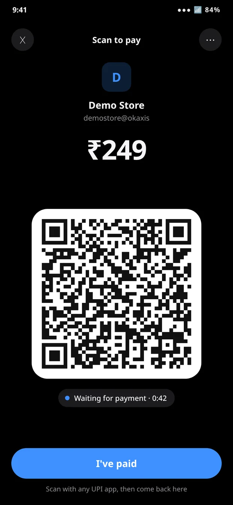
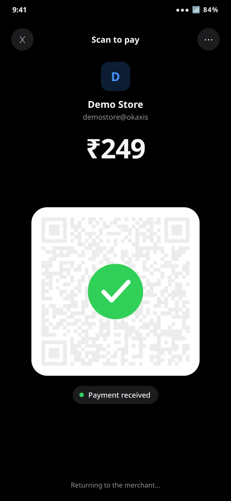

<h1 align="center">UPI QR</h1>

<p align="center"><strong>Pay a "UPI app only" checkout by scanning a QR code.</strong></p>

<p align="center">
  <a href="https://github.com/marsian83/upiqr/releases/latest"></a>
  <a href="https://github.com/marsian83/upiqr/releases"></a>
  
  
  <a href="LICENSE"></a>
</p>

<p align="center">
  <a href="https://github.com/marsian83/upiqr/releases/latest"><strong>Download</strong></a>
  &nbsp;·&nbsp;
  <a href="#how-to-use-it">How to use it</a>
  &nbsp;·&nbsp;
  <a href="#if-it-doesnt-show-up-at-checkout">Not showing up?</a>
  &nbsp;·&nbsp;
  <a href="#limits">Limits</a>
</p>

Lots of Indian apps (food delivery, tickets, bill payments) only let you pay with a UPI app installed on the same phone. They never show a QR code. UPI QR turns that payment into one, so you can pay it from any UPI app on any phone.

<p align="center">
  
  &nbsp;
  
</p>

## The problem

You're ordering food on one phone, but the UPI app you want to pay with is somewhere else: on your other phone, on a family member's phone, or in a service that can only scan QR codes. The checkout won't show you a QR. It just lists the UPI apps on this phone and waits.

A shop counter would show you a QR for exactly this. The app's payment request carries the same information, it just never draws it.

## How to use it

1. **Install it.** Download `upiqr.apk` from the [latest release](https://github.com/marsian83/upiqr/releases/latest) and open it. Android will ask you to allow installs from your browser or file manager.
2. **Pick it at checkout.** Choose UPI, then pick **UPI QR** from the list of apps.
3. **Scan and pay.** Scan the QR with any UPI app, on any phone, and pay as usual. The amount and payee are already filled in.
4. **Go back to the merchant.**
   - If the merchant uses Razorpay, UPI QR spots the payment by itself, shows a green check and takes you back.
   - Otherwise, wait until your UPI app says the payment went through, then tap **I've paid**.

> [!IMPORTANT]
> Don't tap **I've paid** before the money has actually gone through. After you go back, the merchant only checks for your payment for a short time (for some apps, under a minute). Tap too early and it will mark the payment as failed.

The ⋯ menu can also copy or share the payment link, save the QR to your photos, or hand the payment to another UPI app on the same phone.

## If it doesn't show up at checkout

When you pay with UPI, the merchant app has to decide which apps to show you. Apps do this in one of two ways:

- **They ask Android.** Android keeps track of every app that can handle UPI payments, and the merchant app shows all of them. UPI QR appears here like any other UPI app.
- **They use their own list.** The app has a built-in list of payment apps it knows about and only shows the ones from that list that you've installed, ignoring everything else. UPI QR isn't on anyone's list, so it never appears.

Every Android app has a unique ID, called its package name, and these lists check that ID and nothing else:

| App | Package name |
|---|---|
|  | `com.google.android.apps.nbu.paisa.user` |
|  | `com.phonepe.app` |
|  | `net.one97.paytm` |
|  | `in.org.npci.upiapp` |

You can find any app's package name at the end of its Play Store link, after `?id=`.

There's nothing the downloadable APK can do about the second kind. If you build UPI QR yourself, though, you can give your copy the ID of an app from that list that **isn't** installed on your phone:

```sh
PKG=the.other.app.id ./build.sh
```

The merchant will then show your copy under that app's name and logo. Before you do this:

- It only works if the real app isn't installed. You can't have both.
- You're installing an app on your phone under another app's identity. The merchant may not like that, and it may be against their terms.
- **Never share an APK built this way.** A payment app that claims to be a real UPI app looks exactly like the scam apps that steal UPI PINs, and the people you send it to can't check what's inside it. It's a build for your phone only.

## Privacy

- No accounts, ads, analytics or trackers.
- It only uses the internet for one thing: for Razorpay payments, it asks `api.razorpay.com` whether that one payment has arrived.
- It keeps the last payment link on your phone so you can open it again from the app icon. Nothing else is stored.
- It doesn't write payment links to the system log.

## Limits

- **Android only.** On iPhones, merchant apps open specific payment apps directly, and there's no way to send a result back.
- **Auto-confirm only works with Razorpay.** Other payment gateways don't offer a public way to check a payment, so you tap **I've paid** yourself.
- **Payment requests expire.** If you take too long paying from another phone, the merchant may cancel the request. If you'd already paid, they normally refund you automatically.
- **It's a side project.** It has no automated tests and no security audit. Check the amount and payee in your UPI app before you pay, like you would with any QR code.

## Build from source

<details>
<summary><strong>Build it yourself</strong></summary>

You need the Android SDK command-line tools (one platform and the build tools) and a JDK. There's no Gradle.

```sh
./build.sh                  # builds upiqr.apk, signed with a local debug key
./build.sh <adb-serial>     # builds it and installs it on a connected phone
```

Release builds take a keystore from the environment:

```sh
UPIQR_KEYSTORE=path/to/release.jks UPIQR_KEYSTORE_PASS=… ./build.sh
```

To see what the app is doing, turn on its logs with `adb shell setprop log.tag.UPIQR DEBUG`, then run `adb logcat -s UPIQR`.

</details>

## License

[MIT](LICENSE). The QR encoder is Project Nayuki's [QR Code generator](https://github.com/nayuki/QR-Code-generator), also MIT; see [NOTICE](NOTICE).
